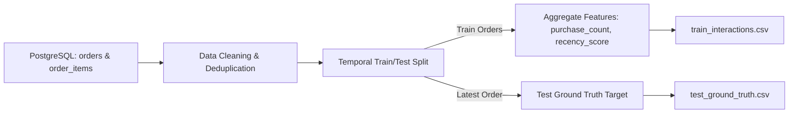

# FreshLoop Recommendation Data Pipeline & Provenance Specification

**Owner:** Trần Hữu Thắng (Data Engineer / Database Developer)  
**Collaborator:** Ngô Hồng Ân (Recommendation & Cache Engineer)  
**Module:** `database/pipeline/extract_interactions.py`  
**Execution:** Weekly batch or offline evaluation run  

---

## 1. Data Provenance & Grocery Domain Modeling

In the grocery sector, purchasing behavior differs sharply from media or generic retail:
- **Repeat Purchases:** Over 70% of a grocery cart consists of repeat items (staples like milk, eggs, bread, fresh greens).
- **Temporal Regularity:** Customers shop in periodic cycles (typically 5–8 days between orders).
- **Synthetic Behavioral Grounding:** In accordance with the *Instacart Market Basket Analysis* benchmark, our dataset models individual customer favorite baskets (8–15 items) sampled with 60%–80% probability per weekly order, blended with 1–3 exploratory items.

---

## 2. Pipeline Architecture (Pandas ETL)

---

## 3. Cleaning & Normalization Rules

1. **Transaction Integrity:** Exclude orders with `status IN ('CANCELLED', 'PENDING')`. Only finalized purchases (`DELIVERED`, `CONFIRMED`) represent true consumer preference.
2. **Missing Key Removal:** Drop records where `order_id`, `user_id`, `product_id`, `quantity`, or `created_at` is null.
3. **Quantity Validation:** Filter out non-positive quantities (`quantity > 0`).
4. **Order-Item Deduplication:** In cases where an SKU was added multiple times within a single order, consolidate by summing quantities (`quantity.sum()`).
5. **UUID Normalization:** Cast all internal database UUIDs to lowercase standard canonical string representations (`str(uuid)`).

---

## 4. Chronological Train/Test Split (Zero Data Leakage)

To scientifically measure the **Precision@10 $\ge$ 65%** metric specified in Section 1.3 of the Proposal:
- **Rule:** A purely random train/test split causes severe data leakage in time-series forecasting (future items leaking into the model's past training data).
- **Temporal Strategy:**
  - For every customer having at least 2 distinct finalized orders:
    - The **most recent order** is withheld as the **Test Set** (Ground Truth).
    - All **preceding orders** constitute the **Training Set**.
  - All feature metrics (`purchase_count`, `days_since_last`, `recency_score`, `implicit_rating`) are derived **strictly from training orders**.
  - The cutoff timestamp $T_{\text{train\_max}}$ is the maximum `created_at` of the training set.

---

## 5. Output Data Contract for Ân (Recommendation Module)

| Artifact | Location | Schema | Consumer |
| :--- | :--- | :--- | :--- |
| **Training Matrix** | `database/data/train_interactions.csv` | `user_id, product_id, purchase_count, total_qty, last_purchased_at, days_since_last, recency_score, implicit_rating` | Ân's ALS / Baseline Model |
| **Test Targets** | `database/data/test_ground_truth.csv` | `user_id, product_id, order_id, quantity` | Offline Evaluator (`Precision@10`, `Recall@10`) |
| **Recommender Sync**| `recommender/sample_output/interactions_sample.csv` | Matches `train_interactions.csv` | Recommender Unit Tests |
