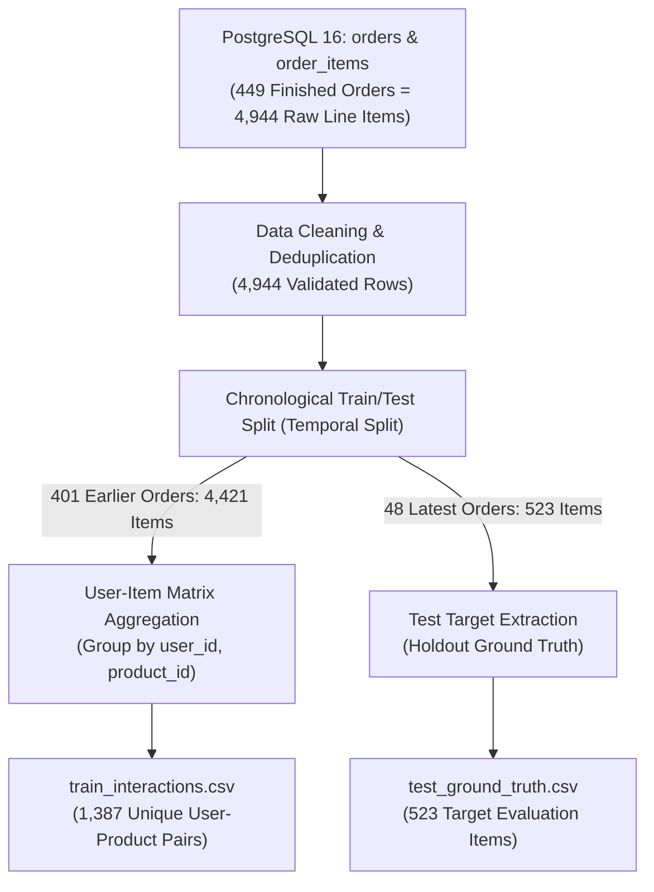

# FreshLoop Recommendation Data Pipeline & Provenance Specification

**Owner:** Trần Hữu Thắng (Data Engineer / Database Developer)  
**Collaborator:** Ngô Hồng Ân (Recommendation & Cache Engineer)  
**Module:** `database/pipeline/extract_interactions.py`  
**Execution:** Weekly batch or offline evaluation run  

---

## 1. Data Provenance & Grocery Domain Modeling

In the grocery sector, purchasing behavior differs sharply from media or generic retail:
- **Repeat Purchases:** Over 70% of a grocery cart consists of repeat items (staples like milk, eggs, bread, fresh greens).
- **Temporal Regularity:** Customers shop in periodic cycles (typically 5–8 days between orders).
- **Synthetic Behavioral Grounding:** In accordance with the *Instacart Market Basket Analysis* benchmark, our dataset models individual customer favorite baskets (8–15 items) sampled with 60%–80% probability per weekly order, blended with 1–3 exploratory items.

---

## 2. Pipeline Architecture (Pandas ETL)

---

## 3. Cleaning & Normalization Rules

1. **Transaction Integrity:** Exclude orders with `status IN ('CANCELLED', 'PENDING')`. Only finalized purchases (`DELIVERED`, `CONFIRMED`) represent true consumer preference.
2. **Missing Key Removal:** Drop records where `order_id`, `user_id`, `product_id`, `quantity`, or `created_at` is null.
3. **Quantity Validation:** Filter out non-positive quantities (`quantity > 0`).
4. **Order-Item Deduplication:** In cases where an SKU was added multiple times within a single order, consolidate by summing quantities (`quantity.sum()`).
5. **UUID Normalization:** Cast all internal database UUIDs to lowercase standard canonical string representations (`str(uuid)`).

---

## 4. Chronological Train/Test Split (Zero Data Leakage)

To scientifically measure the **Precision@10 $\ge$ 65%** metric specified in Section 1.3 of the Proposal:
- **Rule:** A purely random train/test split causes severe data leakage in time-series forecasting (future items leaking into the model's past training data).
- **Temporal Strategy:**
  - For every customer having at least 2 distinct finalized orders:
    - The **most recent order** is withheld as the **Test Set** (Ground Truth).
    - All **preceding orders** constitute the **Training Set**.
  - All feature metrics (`purchase_count`, `days_since_last`, `recency_score`, `implicit_rating`) are derived **strictly from training orders**.
  - The cutoff timestamp $T_{\text{train\_max}}$ is the maximum `created_at` of the training set.

---

## 5. Output Data Contract for Ân (Recommendation Module)

| Artifact | Location | Schema | Consumer |
| :--- | :--- | :--- | :--- |
| **Training Matrix** | `database/data/train_interactions.csv` | `user_id, product_id, purchase_count, total_qty, last_purchased_at, days_since_last, recency_score, implicit_rating` | Ân's ALS / Baseline Model |
| **Test Targets** | `database/data/test_ground_truth.csv` | `user_id, product_id, order_id, quantity` | Offline Evaluator (`Precision@10`, `Recall@10`) |
| **Recommender Sync**| `recommender/sample_output/interactions_sample.csv` | Matches `train_interactions.csv` | Recommender Unit Tests |

---

## 6. Mathematical Breakdown & Row Count Accounting (No Data Loss)

A common point of confusion in data pipelines is comparing raw order line items against aggregated interaction pairs. Here is the exact mathematical accounting proving **zero data loss**:

| Pipeline Stage | Dataset / Scope | Row Count | Unit of Analysis / Entity | Explanation |
| :--- | :--- | :---: | :--- | :--- |
| **Raw Extraction** | Finished Orders (`DELIVERED`, `CONFIRMED`) | **4,944** | Order Line Items | All items purchased across 449 completed orders. |
| **Temporal Split** | **Train Set** (Earlier orders 1..N-1) | **4,421** | Order Line Items | 401 historical orders used for model training. |
| **Temporal Split** | **Test Set** (Latest order N per customer) | **523** | Order Line Items | 48 holdout orders used as Ground Truth targets. |
| **Sum of Split** | Train Items + Test Items | **4,944** | Order Line Items | $4,421 + 523 = 4,944$. **Exactly 100% of data is preserved.** |
| **Feature Aggregation** | `train_interactions.csv` | **1,387** | **Unique `(user_id, product_id)` Pairs** | Collaborative Filtering (ALS) requires unique customer-item matrix coordinates. Multiple purchases of the same SKU by a customer across their weekly orders collapse into 1 pair with repeat counter `purchase_count`. |
| **Ground Truth Export** | `test_ground_truth.csv` | **523** | Test Target Items | The un-aggregated items from each customer's final order to test if the top-10 recommended SKUs match what they actually bought next. |

### Why do 4,421 Train Items collapse into 1,387 Pairs?
In grocery shopping, users purchase the same staple products repeatedly across consecutive weeks:
$$\text{Average Orders Per User} \approx 9.35 \quad \implies \quad \text{Average Repeat Ratio} = \frac{4,421 \text{ train lines}}{1,387 \text{ unique pairs}} \approx 3.19 \text{ purchases per pair}$$
- A customer who ordered *Tomato 500g* in 7 different weekly training orders has **7 distinct line items** in the raw database.
- In `train_interactions.csv`, these 7 rows are grouped into **1 interaction row**:
  - `purchase_count = 7`
  - `total_qty = 14`
  - `implicit_rating = 7 \times e^{-0.05 \times \Delta t}`
- This aggregation is standard practice in Collaborative Filtering and is essential for preventing skewed loss calculations during Matrix Factorization.
