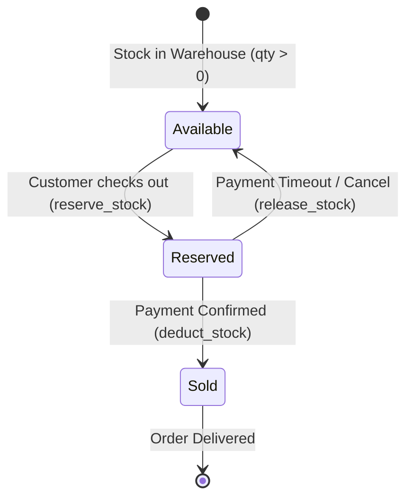

# FreshLoop Inventory Lifecycle & Concurrency Specification

**Module:** `database/` & `backend/`  
**Authors:** Trần Hữu Thắng (Database Engineer) & Mai Danh Tiến (Backend Engineer)  
**Status:** Agreed & Frozen (Week 2 Day 1 Integration Decision)  

---

## 1. Core Inventory Definitions

At FreshLoop, stock is tracked per **Warehouse** rather than globally:
- **`quantity`** (`INTEGER`): Total physical stock located in the warehouse shelves.
- **`reserved_quantity`** (`INTEGER`): Stock temporarily locked for checkout/payment processing or pending fulfillment.
- **`available_quantity`** (Computed): The actual stock available for new customer carts:
  $$\text{available\_quantity} = \text{quantity} - \text{reserved\_quantity}$$

### Database Constraints (Enforced at PostgreSQL Engine Level)
1. `CHECK (quantity >= 0)`: Physical stock can never drop below zero (`chk_inventory_qty_non_negative`).
2. `CHECK (reserved_quantity >= 0)`: Reserved stock can never be negative (`chk_reserved_qty_non_negative`).
3. `CHECK (reserved_quantity <= quantity)`: Reserved units can never exceed physical shelf stock (`chk_reserved_le_quantity`), preventing overselling at the database engine level.
4. `UNIQUE (product_id, warehouse_id)`: Exactly one inventory ledger entry per product per warehouse (`uq_product_warehouse`).

---

## 2. Order Fulfillment Model (MVP Day 1 Freeze)

- **Single-Warehouse Fulfillment:** For the MVP, an entire order is fulfilled by **one selected warehouse** (`orders.warehouse_id`). Multi-warehouse splitting is deferred to Phase 2.
- **Warehouse Routing Rule:** When a customer checks out, the backend validates available stock at the customer's nearest service zone warehouse.

---

## 3. Inventory Lifecycle State Machine



### Stage 1: Stock Reservation (`RESERVE`)
- **Trigger:** Customer submits cart for checkout (`POST /api/v1/orders`).
- **Condition:** Must verify:
  $$\text{quantity} - \text{reserved\_quantity} \ge \text{requested\_qty}$$
- **Atomic Database Mutation:**
  ```sql
  -- Acquire row lock to prevent race condition
  SELECT inventory_id, quantity, reserved_quantity 
  FROM inventory_levels 
  WHERE warehouse_id = :wh_id AND product_id = :prod_id 
  FOR UPDATE;

  -- If (quantity - reserved_quantity) >= :requested_qty:
  UPDATE inventory_levels 
  SET reserved_quantity = reserved_quantity + :requested_qty,
      updated_at = NOW()
  WHERE warehouse_id = :wh_id AND product_id = :prod_id;
  ```
- **Result:** Order created with `status = 'PENDING'`.

### Stage 2: Stock Deduction (`DEDUCT`)
- **Trigger:** Payment confirmed / Order confirmed (`status -> 'CONFIRMED'`).
- **Atomic Database Mutation:**
  ```sql
  UPDATE inventory_levels 
  SET quantity = quantity - :requested_qty,
      reserved_quantity = reserved_quantity - :requested_qty,
      updated_at = NOW()
  WHERE warehouse_id = :wh_id AND product_id = :prod_id;
  ```
- **SSE Notification:** If `quantity == 0`, trigger SSE event:
  `{ sku: '...', warehouse_id: '...', quantity: 0, status: 'OUT_OF_STOCK' }`  
  and Redis cache invalidation (`HDEL predicted_cart:{user_id} {product_id}`).

### Stage 3: Stock Release (`RELEASE`)
- **Trigger:** Checkout timeout (15 mins), card declined, or order cancelled (`status -> 'CANCELLED'`).
- **Atomic Database Mutation:**
  ```sql
  UPDATE inventory_levels 
  SET reserved_quantity = reserved_quantity - :requested_qty,
      updated_at = NOW()
  WHERE warehouse_id = :wh_id AND product_id = :prod_id;
  ```

---

## 4. Concurrency & Overselling Prevention

To guarantee that two customers cannot purchase the last remaining stock units simultaneously:
1. All stock mutations **MUST** run within a transaction block (`session.begin()`).
2. Use **Pessimistic Row-Level Locking** via `with_for_update()` in SQLAlchemy:
   ```python
   inventory = (
       session.query(InventoryLevel)
       .filter_by(warehouse_id=wh_id, product_id=prod_id)
       .with_for_update()
       .one()
   )
   if inventory.quantity - inventory.reserved_quantity < requested_qty:
       raise InsufficientStockError("Insufficient stock available.")
   inventory.reserved_quantity += requested_qty
   ```

### Experimental Verification & Unit Testing (`database/tests/test_integrity_constraints.py`)

A rigorous test simulation was implemented with 2 concurrent worker threads competing for inventory:
- **Initial Inventory State:** $\text{quantity} = 5$, $\text{reserved\_quantity} = 0 \implies \text{available} = 5$.
- **Concurrent Load:** Client A requests 3 units, Client B requests 3 units (Total demand: $3 + 3 = 6 > 5$).

| Execution Strategy | Client A Outcome | Client B Outcome | Final Reserved Qty | Overselling? | Test Assertion |
| :--- | :---: | :---: | :---: | :---: | :--- |
| **WITH Row Lock**<br/>(`SELECT ... FOR UPDATE`) | **SUCCESS**<br/>(Reserves 3) | **OUT_OF_STOCK**<br/>(Rejected: only 2 left) | **3 / 5** | **NO**<br/>(Correct Behavior) | Exactly 1 client succeeds, 1 rejected. Stock invariant holds. |
| **WITHOUT Row Lock**<br/>(Plain `SELECT`) | **SUCCESS**<br/>(Reads avail=5, buys 3) | **SUCCESS**<br/>(Reads avail=5, buys 3) | **6 / 5** | **YES**<br/>(Critical Bug) | Both clients succeed during race window ($t = 0.05\text{s}$), selling 6 units out of 5! |

### Engine-Level Safety Net
Even if application logic fails or a developer forgets `.with_for_update()`, PostgreSQL's **`CHECK (reserved_quantity <= quantity)`** constraint raises an immediate `IntegrityError` at `COMMIT`, forcing a database rollback before corrupted inventory can persist.
